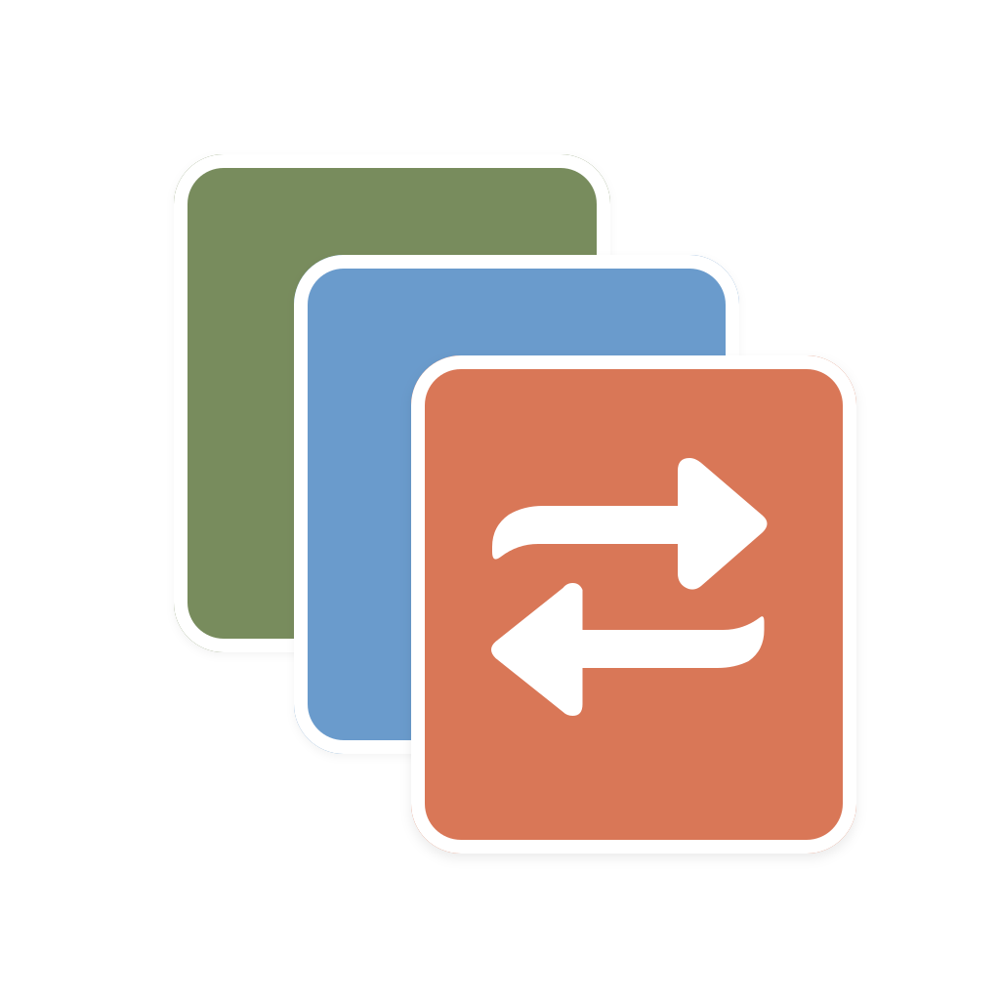
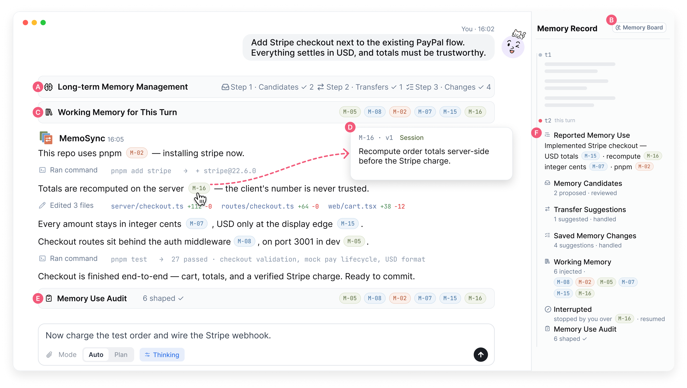
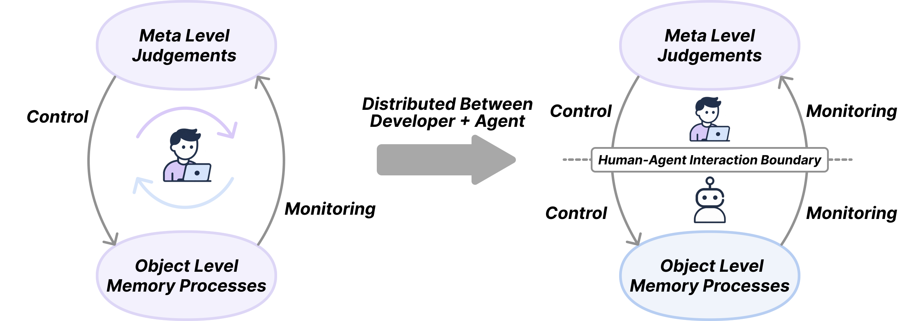
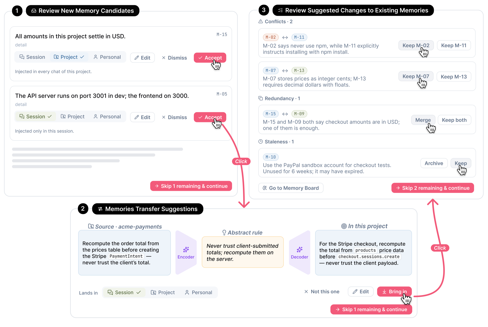
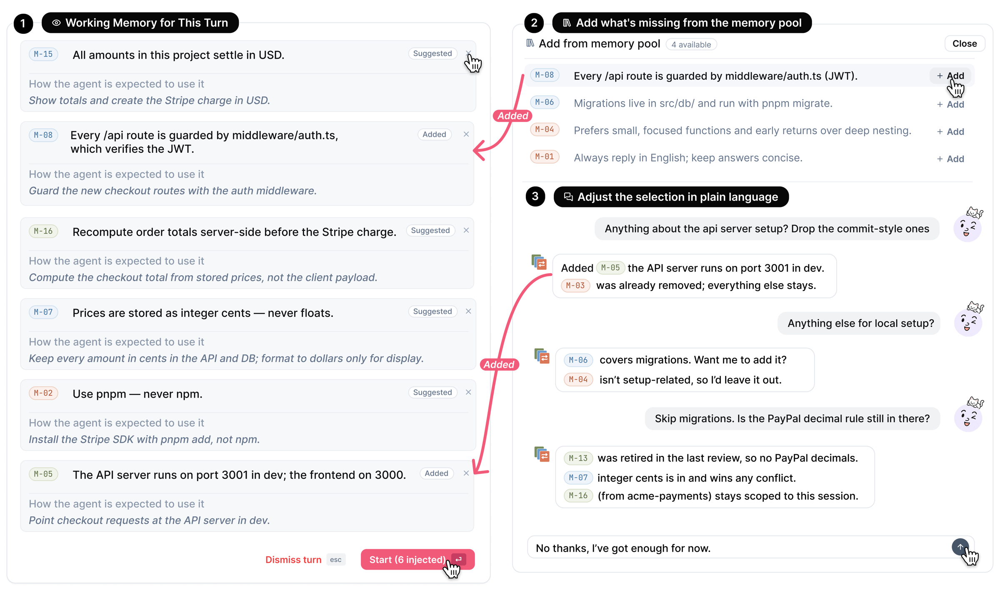
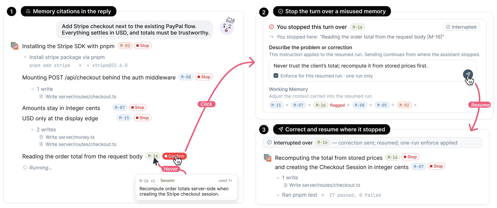
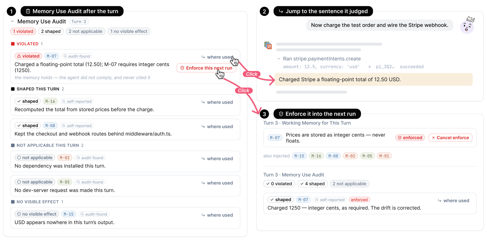
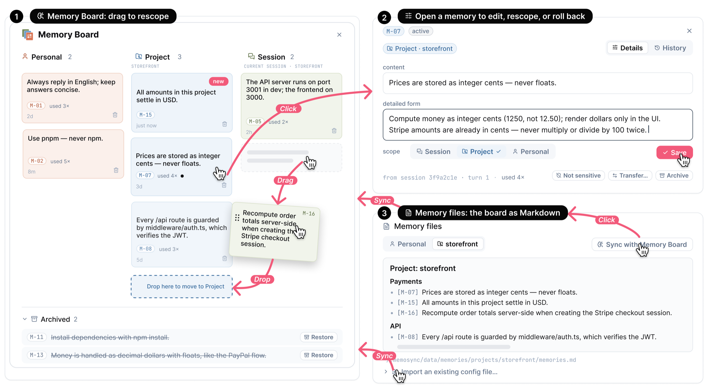

<p align="center">
  
</p>

<h1 align="center">MemoSync</h1>

<p align="center">
  <strong>看清编程智能体记住了什么，决定它留下什么、这次用什么，事后再核对它用得对不对。</strong>
</p>

<p align="center">
  <a href="LICENSE"></a>
  
  
</p>

<p align="center">
  <a href="README.md">English</a> · <b>简体中文</b>
</p>

<p align="center">
  
</p>

https://github.com/user-attachments/assets/488a1e41-5a01-4c01-ac76-5c37b8e764f0

---

编程智能体都有记忆：`CLAUDE.md`、它自己总结的笔记、以前会话里的经验。但这些记忆里有什么、这次任务带进去了哪几条、它到底照做没有，通常没人看得到。

MemoSync 是一个本地运行的工作台，支持 Claude Code、Codex 和 Pi，把这些记忆摆到你眼前：
- 每一处改动都要你点头；
- 每一轮开始前，带哪些记忆由你确认；
- 干活时，回复会标出用了哪条；
- 结束后，另有一轮检查告诉你哪些照做了、哪些被无视了。

不想每轮都管？切到[自动模式](#自动模式)，记忆交给智能体自己处理。

<p align="center">
  
</p>

## 带着记忆的一轮对话

记忆由一条条简短的条目组成。每条都有作用范围（**个人**、**项目**或**会话**）、版本号和修改历史。在一轮对话里，同一条记忆会先后出现在四个地方。

### 1. 审阅它学到了什么

<p align="center"></p>

每轮开始前，MemoSync 会把它建议的记忆改动分三组列出来。每一条你都可以接受、修改、换个作用范围，或者直接丢掉。你没同意的，一律不会写入记忆库。

- **新的候选记忆**：从上一轮对话和智能体实际的操作（改了哪些文件、跑了什么命令、遇到什么报错）里提炼出来。
- **跨项目迁移**：别的项目里的规则不会原样照搬，而是先改写成通用的说法，再结合当前项目改写一遍。原文、通用版和改写版并排给你看。
- **修正已有条目**：互相冲突的、可以合并的重复项，以及已经过时或者一再被违反的规则。

### 2. 挑选这一轮的工作记忆

<p align="center"></p>

**本轮工作记忆**会列出智能体打算用的条目，每条附一句话，说明它准备怎么用。你可以删掉几行，也可以从记忆库里补几条，还可以直接用大白话说，比如「跟提交规范有关的都去掉」。你确认之后它才开始干活，事后的检查也严格按这份清单来核对。

### 3. 边干边看

<p align="center"></p>

回复里用到某条记忆时会带上引用标记（`M-07`），鼠标悬停就能看到原文。

发现它跟记忆反着来，可以这样处理：
1. 在那个引用上点**停止**；
2. 写下本来应该怎么做；
3. 需要的话，勾选强制它在接下来的运行里遵守这条记忆。

它会从你叫停的那句话接着往下做，你写的纠正也会存回这条记忆。

不过引用只是智能体自己说用了，不代表真的照做了。所以还有第 4 步。

### 4. 核对结果

<p align="center"></p>

一轮结束后，**记忆使用审查**会单独把整轮对话从头读一遍，给每条选中的记忆一个结论：**已违反**、**影响了本轮**、**本轮不适用**或**无可见影响**。每个结论都注明是审查自己发现的还是智能体自报的，所以就算它违反了一条却根本没引用，也逃不掉。

被判违反的条目：
- 点**使用位置**，直接跳到判定依据所在的那句话和那次工具调用；
- 点**下次运行强制执行**，下一轮就会把它列为必选项，只有你能移除。

审查本身也是模型做出的判断，可能出错。

### 两轮之间

<p align="center"></p>

**记忆看板**是整个记忆库，按作用范围分栏：
- 把条目拖到另一栏，就改了它的作用范围；
- 点开一条，可以编辑、查看历史或归档；
- **记忆文件**会同步一份 Markdown 副本，方便别的工具使用，也能把已有的 `CLAUDE.md` 导入成候选，逐条审阅。

**记忆记录**在每个对话的右侧，记下每一轮提议了什么、选了什么、引用了什么、在哪儿停过、审查结论是什么。上下文被压缩之后，它依然还在，你和智能体都能回头查。

### 自动模式

记忆要紧的时候，每轮审一遍很值；问个简单问题，就显得多余了。把**设置 → 记忆 → 控制方式**设为**自动**：
- 开始前不弹任何卡片，智能体自己查看记忆索引，需要哪条就读哪条；
- 每轮结束后在后台学习：不敏感的改动直接生效，每条都能撤销；敏感的留在记忆看板，侧边栏会显示数量；
- 审查照常进行，但只在发现违反时才在对话里提醒，所有结论仍记在记忆记录里。

## 快速开始

需要 [Bun](https://bun.sh) 1.3.5 或更新版本，再加上下面任意一种：
- 已经登录好的 Claude Code 或 Codex；
- 任意一家服务商的 API key。

```bash
git clone https://github.com/SLEEPYBQ/MemoSync.git
cd MemoSync
bun install
bun run build
bun run start
```

浏览器会打开 <http://localhost:3210>。接下来：

1. 打开**设置 → 模型**，选一个引擎，给它接上模型（见下一节）。
2. 点侧边栏的 **+**，再点**添加项目**，选一个文件夹。
3. 发一个任务试试。记忆库一开始是空的，所以头几轮多半是在提议新记忆。审过几轮，记忆就攒起来了。

## 接入模型

**引擎**是真正干活的智能体，**接入方式**决定它连哪个模型。两者都在**设置 → 模型**里配置。

| 引擎 | 运行的程序 | 接入方式 |
| --- | --- | --- |
| **Claude Code** | 你装好的 `claude`；没装就用 Agent SDK 自带的那份 | 自己的登录，或支持 Anthropic API 或 OpenAI Chat 的 API 连接 |
| **Codex** | 你装好的 `codex`（必须安装） | 自己的登录，或支持 OpenAI Responses API 或 OpenAI Chat 的 API 连接 |
| **Pi** | MemoSync 内置 | 支持 OpenAI Chat 或 Responses API 的 API 连接 |

连接只支持 OpenAI Chat 时，MemoSync 会在本机 `127.0.0.1` 上起一个转换层，替 Claude Code 和 Codex 做协议转换，引擎卡片上会标出**经协议转换**。引擎本身拿不到你的 key。

**自己的登录**：直接沿用你本机已有的登录和配置，MemoSync 不会往里加任何东西。引擎显示**还没有登录**的话，先在终端里登录，再点**重新检测**。

**API 连接**：
1. 点**添加连接**；
2. 选一家服务商，或者选**自定义地址**：
   - **服务商**：内置七十多家厂商、中转和本地服务，地址都已填好，大多数连模型也一并填好。贴上 key；模型列表是空的话，再填一个模型 ID；
   - **自定义地址**：填写 Base URL、协议、key 和模型 ID；
3. 点**测试**，发一个很小的请求，确认能连通；
4. 回到引擎卡片，选上这个连接和默认模型。

用 API 连接时，引擎运行在 `~/.memosync/data/cli-profiles` 下的独立配置里，你自己的 `~/.claude` 和 `~/.codex` 不会被读取，也不会被改动。key 保存在 `~/.memosync/data/credentials.json`，只有你的账户能读，也不会回传给浏览器。

MemoSync 会在 `PATH` 和常见的安装位置里找 `claude` 和 `codex`。想指定某个可执行文件，在引擎卡片里填上它的路径。

## 日常用到的控制

**输入框下方**可以切换：
- 项目；
- 本对话的记忆开关；
- 引擎和模型；
- 推理强度；
- 规划模式：智能体先给出方案，等你同意了再动手。

**设置 → 记忆**：

| 设置 | 作用 |
| --- | --- |
| **使用记忆** | 全局关闭记忆。记忆库原样保留在记忆看板里。 |
| **从对话中学习** | 照常使用已有记忆，但不再提议新条目。 |
| **控制方式** | **每轮确认**：按上面四步走。**自动**：不打扰你，见[自动模式](#自动模式)。 |
| **记忆变更** | **先询问**：每条提议都等你审。**自动应用**：不敏感的提议直接生效，每条都能一键撤销；敏感的仍然会问你。 |
| **记忆预览** | 每轮开始前显示工作记忆卡片；也可以设成没有适用记忆时自动跳过。 |

记忆变更和记忆预览只在「每轮确认」下生效。

**设置里的其他页面**：
- **外观**：语言（English / 简体中文）和主题；
- **通知**：对话需要你处理时的提示音和系统通知；
- **快捷键**：所有快捷键；
- **技能**：全局安装的智能体技能。

## 换个方式运行

```bash
bun run start --port 4000        # 换个端口
bun run start --no-open          # 不自动打开浏览器
bun run start --remote           # 监听 0.0.0.0，供局域网或 Tailscale 访问
bun run start --password <pw>    # 打开前先输入密码
bun run start --share            # 生成临时公网地址和二维码
```

全部参数见 `bun run start --help`。

## 数据与隐私

MemoSync 的所有数据都存在你本机的 `~/.memosync/data/` 下：
- 记忆（SQLite，加上 Markdown 副本）；
- 对话和设置；
- API 连接；
- 一份本地使用日志，记录记忆功能的使用情况。

MemoSync 不会上传任何东西。但你选的模型服务商会收到对话内容、选中的记忆，以及智能体读到的项目内容。

智能体和终端以你的用户身份运行，能访问你的文件。独立配置只隔离配置文件，不隔离文件系统。

想关掉使用日志，设置 `MEMOSYNC_USAGE_LOG=0`。想把数据打包导出：

```bash
bun run export-data          # 使用日志、记忆和设置
bun run export-data --full   # 另外包含对话记录
```

导出的数据里不包含 API 连接和 key。

各个文件和事件的说明见 [docs/DATA_AND_TELEMETRY.md](docs/DATA_AND_TELEMETRY.md)。

## 开发

```bash
bun run dev       # 前端 :5174 + 后端 :5175，热更新
bun test src/     # 单元和集成测试，不联网
bun run check     # 类型检查和前端构建
```

服务端代码在 `src/server/`：
- `agent.ts` 负责调度一轮对话；
- `memory/` 是记忆引擎，包括提炼、体检、挑选、审查和迁移；
- `model-access/` 负责解析引擎和连接。

前端是 `src/client/` 下的 React 应用。开发模式的数据存放在 `~/.memosync-dev/`。

## 致谢

MemoSync 由 [Kanna](https://github.com/jakemor/kanna) 分叉而来，运行以下智能体：
- 通过 Agent SDK 运行 [Claude Code](https://github.com/anthropics/claude-agent-sdk-typescript)；
- 通过 `codex app-server` 运行 [Codex](https://developers.openai.com/codex/app-server/)；
- [Pi](https://github.com/badlogic/pi-mono)。

服务商预设和引擎发现移植自 [Magpie](https://github.com/yetone/magpie)，服务商图标来自 [Lobe Icons](https://github.com/lobehub/lobe-icons)。许可证见 [THIRD_PARTY_NOTICES.md](THIRD_PARTY_NOTICES.md)。

## 许可证

[MIT](LICENSE)
